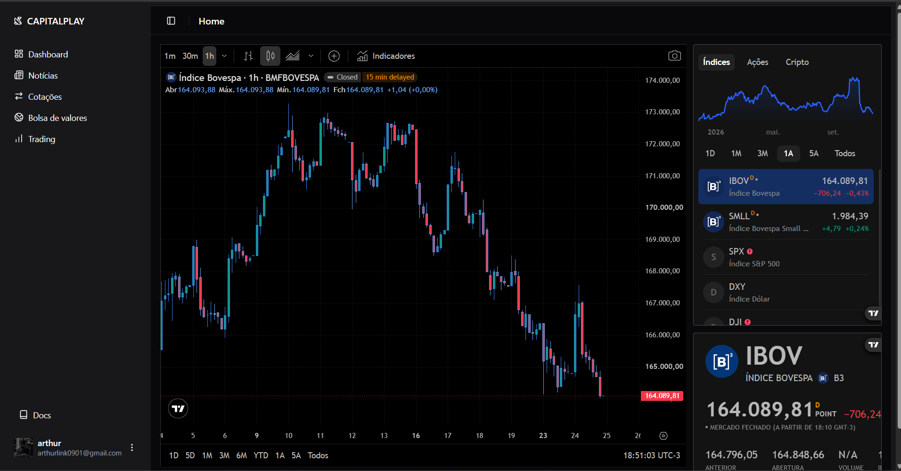

# CapitalPlay — Plataforma Gamificada de Educação Financeira
🔗 **Demo em produção:** [capitalplay.vercel.app](https://capitalplay.vercel.app)
> 
---
## 🎯 Problema Resolvido
Aprender sobre mercado financeiro e tomada de decisão econômica costuma ser abstrato quando baseado apenas em teoria — ou arriscado quando feito diretamente com dinheiro real.
O **CapitalPlay** resolve esse problema oferecendo uma **dashboard financeira gamificada** conectada a **dados de mercado em tempo real**, permitindo que usuários pratiquem análises, acompanhem ativos e façam simulações econômicas interativas em um ambiente seguro.
---
## 🛠️ Stack Utilizada
- **Framework & Linguagem:** Next.js 16, React 19, TypeScript
- **Dados Financeiros & Validação:** Yahoo Finance API (`yahoo-finance2`), Zod
- **Back-End & Autenticação:** Firebase & Firebase Admin (`firebase`, `firebase-admin`)
- **Visualização de Dados:** Recharts, Visx, TanStack Table
- **Interface & Animações:** Tailwind CSS 4, Radix UI, HeroUI, Framer Motion, Three.js (`@react-three/fiber`), Sonner
- **Deploy:** Vercel
---
## ✨ Principais Funcionalidades
- Consumo de cotações e indicadores financeiros via integração com **Yahoo Finance API**
- Gráficos e tabelas interativas para análise de ativos e simulações econômicas
- Autenticação e persistência de progresso dos usuários com **Firebase**
- Experiência gamificada com interface responsiva e componentes acessíveis
---
## ▶️ Como Rodar Localmente
```bash
# 1. Clone o repositório
git clone https://github.com/arthuur01/capitalplay.git
cd capitalplay
# 2. Instale as dependências
npm install
# 3. Configure as variáveis de ambiente (.env.local) com as credenciais do Firebase
# 4. Inicie o servidor local
npm run dev
```
Acesse [http://localhost:3000](http://localhost:3000) no navegador.
---
## 👤 Autor & Papel no Projeto
**Arthur Miguel Vieira Mapa** — Desenvolvimento Full-Stack / Integração de APIs e atuação como **Scrum Master**.  
[LinkedIn](https://linkedin.com/in/arthur-miguel-mapa) | [GitHub](https://github.com/arthuur01)

## Documentação oficial
[Docs](https://bristle-mandevilla-e3e.notion.site/Documenta-o-CapitalPlay-2aff4f91f52980969e65e929dbf3273c)
